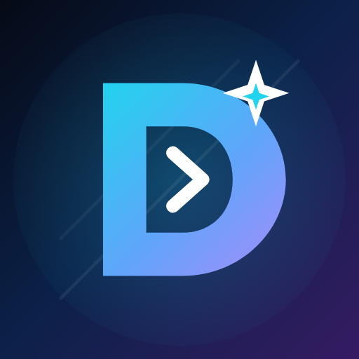

<p align="center">
  
</p>

# DevAI Studio

**Android-студия для разработки с ИИ.** Чат с ведущими моделями, генерация Android-проектов, рабочее пространство с файлами и офлайн-модели, которые работают без интернета.

[Скачать APK](https://github.com/Karishka-sr/devai-studio/releases) · **v3.6.2** · Android 12+ · arm64-v8a
[Сайт API](https://karishka-sr.github.io/devai-studio/) · **DevAI Core API** · ключ за 10 секунд
[Скачать PC-версию](https://github.com/Karishka-sr/devai-studio-pc/releases/latest) · **Windows 7/10/11 · 3.2.0** · JRE 8 внутри

<p align="center">
  <a href="https://t.me/NeonBeatt">
    
  </a>
  <a href="https://github.com/Karishka-sr/devai-studio/releases">
    
  </a>
  <a href="https://rytmix-live.pplx-2.app">
    
  </a>
  <a href="https://karishka-sr.github.io/devai-studio/">
    
  </a>
</p>

## PC-версия для Windows

- Установщик NSIS с выбором Windows 7, Windows 10 или Windows 11.
- Страница «Компоненты»: полная версия, Vexel APK, ADB и ярлыки.
- Внутри уже есть Java Runtime 8 — отдельная Java не нужна.
- Чат, веб-поиск, настройки провайдеров и вкладка Vexel.
- Vexel входит в установщик как APK; ADB и ярлык «Vexel» ставят его в эмулятор.
- Исходники PC-версии: https://github.com/Karishka-sr/devai-studio-pc
- Модуль в этом репозитории: `desktop/`.

## Возможности

### 🌐 75 языков программирования
- Выбор основного языка: Kotlin, Java, Python, JavaScript, TypeScript, Dart, Swift, C, C++, C#, Go, PHP, Ruby, SQL, Bash, HTML/CSS, Haxe, Vala, Ballerina, Racket, GLSL, GDScript и ещё десятки.
- Язык подставляется в системный промпт: примеры, тесты и команды приходят на выбранном языке.
- Экран выбора с поиском, примерами кода и копированием.
- Каталог языков лежит файлами в `languages/*.json` (75 JSON-файлов) и не встраивается в `assets`.
- На телефоне приложение читает `files/languages` и `Android/data/com.devai.studio/files/languages`; при первом запуске туда распаковывается стартовый набор.
- Чтобы добавить язык, положите JSON в `Android/data/com.devai.studio/files/languages` — пересборка не нужна.
- Чтобы добавить язык, достаточно положить новый JSON в эту папку — Kotlin-код менять не нужно.
- Подсветка синтаксиса прямо в чате: ключевые слова, типы, строки, комментарии, числа, аннотации и функции.
- Автоопределение языка для блоков кода без подписи и алиасы `js`, `ts`, `c++`, `c#`, `objective-c`.
- Вложения принимают расширения всех 75 языков.
- В Android-версии подсветка встроена в чат; в PC-версии выбор языка влияет на генерацию.

### 💬 Чат с ИИ
- **DevAI Core** — собственный провайдер: модель `devai-core-0.1`, бесплатный ключ с сайта и вставка ключа из буфера в приложении.
- **Интернет в реальном времени** — DevAI Core автоматически ищет в вебе, новостях, Wikipedia, GitHub и Stack Overflow, показывает источники и текущую дату.
- **Проверка обновлений** — приложение смотрит релизы на GitHub и показывает сверху баннер «Вышло обновление!» с кнопкой «Скачать».
- 25+ провайдеров: OpenAI, Anthropic Claude, Google Gemini, DeepSeek, Groq, Mistral, OpenRouter, Together AI, Cerebras, NVIDIA NIM, xAI, Cohere, Perplexity и другие.
- Локальные серверы: Ollama, LM Studio, llama.cpp, Jan.
- Свой OpenAI-совместимый сервер.
- Стриминг ответов, история сессий, регенерация, Markdown и блоки кода с копированием.

### 🧠 DevAI Core v0.1
- Собственный ИИ-слой DevAI Studio: отдельный режим **«DevAI Core»**.
- Локальные навыки без API-ключа: память, поиск по 1024 промптам, справка по нику/SMS/языкам/моделям, проверка системы и время.
- Память на устройстве: «Запомни: ...», «Что ты помнишь?», «Забудь всё».
- Если подключён провайдер, Core оркестрирует выбранную модель со своим системным промптом; если нет — отвечает локально и предлагает подключить модель.
- Первая версия — это не обученная с нуля модель, а собственный слой ассистента с памятью, навыками и маршрутизацией.
- **Сервер DevAI Core API** (`server/`): OpenAI-совместимый `/v1/chat/completions`, потоковые ответы и API-ключи с лимитами. Инструкция — `server/README.md`.

### 🧰 Инструменты и плагины
- **MCP-инструменты**: подключение внешних серверов, токены, tool calling в чате.
- **Веб-поиск Tavily**: результаты поиска добавляются в контекст ответа.
- **TTS**: системное озвучивание ответов и кнопка «Озвучить» у каждого сообщения.
- **Профиль и SMS-регистрация**: смена ника, вход по номеру телефона через Firebase Phone Auth, хранение номера и uid в EncryptedSharedPreferences.
- **Мега-настройки**: живая сводка T/Top-P/токены/язык/тема, 5 профилей генерации в один тап, 8 быстрых переключателей и поиск по смыслу (температура, тема, модель, вибрация, обои, ключи).
- **Мега-библиотека промптов**: 1024 готовых промпта — 40 стеков (Kotlin, Python, Rust, Go, Docker, Kubernetes, SQL и другие) × 25 задач (API, тесты, ревью, CI/CD, безопасность и другие) + поиск.
- **Карточки персонажей**: имя, характер, приветствие и системный промпт.
- **QR-экспорт провайдера**: перенос профиля между устройствами без облака.
- **Файлы в чате**: до 3 текстовых вложений, до 64 КБ каждое.
- **Плагины `.devai`**: настоящий Lua 5.2 через LuaJ (MIT) в песочнице. Команды для пользователя и инструменты, которые ИИ вызывает сам. Старый DPL-формат тоже поддерживается.
- **Документация по плагинам**: отдельный `docs/PLUGINS.md` и кнопка скачивания внутри приложения.

### 📴 Офлайн-модели
Модели скачиваются внутрь приложения и работают **без интернета**. Инференс выполняется на устройстве через LiteRT-LM, данные не покидают телефон.

| Модель | Размер | Доступ |
|---|---|---|
| SmolLM 135M | ~159 МБ | Бесплатно |
| LFM2.5 350M | ~248 МБ | Бесплатно |
| SmolLM2 360M | ~374 МБ | Бесплатно |
| Granite 4.0 H 350M | ~436 МБ | Бесплатно |
| Qwen2.5 0.5B | ~547 МБ | Бесплатно |
| Qwen3 0.6B | ~614 МБ | Бесплатно |
| LFM2.5 1.2B Instruct | ~736 МБ | Premium · Неделя |
| Qwen2.5 Coder 1.5B | ~1.12 ГБ | Premium · Месяц |
| TinyLlama 1.1B | ~1.15 ГБ | Premium · Неделя |
| Qwen2.5 1.5B | ~1.60 ГБ | Premium · Неделя |
| Qwen3 1.7B | ~1.75 ГБ | Premium · Месяц |
| DeepSeek R1 Distill 1.5B | ~1.86 ГБ | Premium · Год |
| SmolLM3 3B | ~2.00 ГБ | Premium · Год |
| Phi-4 Mini Instruct | ~3.94 ГБ | Premium · Год |

- Докачка после отмены, прогресс, удаление.
- Импорт своего `.task` или `.litertlm` и добавление модели по прямой ссылке.
- Запасное зеркало Hugging Face (`hf-mirror.com`), если основной адрес недоступен.
- Промпт для LiteRT-LM теперь plain-text: служебные токены (`<bos>`, `<|im_start|>`, `<start_of_turn>`) удаляются, поэтому ошибка «Input contains bos control token» больше не появляется.

### 🏗 Конструктор Vexel
- Полноценный визуальный редактор интерфейсов в стиле Material 3 Expressive.
- Проекты, слои, фигуры MD3, компоненты, маски, градиенты, тени и режим «Играть».
- Экспорт PNG/SVG, импорт SVG и генерация Compose-кода.
- Полный набор иконок Vexel: 23 670 SVG Material Symbols (outlined/rounded/sharp) в `assets/icons`.
- Баннер убран по запросу; в «Автор» осталась текстовая атрибуция, Telegram и сайт.
- Открывается из вкладки «Конструктор» на весь экран.
Конструктор взят у https://t.me/cheburek_dev, Разрешение есть, оригинальный конструктор Vexel скачивать с этого тгк

### 🧩 Compose UI
- Чат, ИИ-провайдеры и Настройки полностью переписаны на Compose; старые XML-фрагменты и адаптеры удалены.
- Загрузочный экран при старте: логотип, «DevAI Studio», индикатор и плавный переход в приложение.
- Главный экран — Compose `Scaffold` + `NavigationBar`.
- Настоящие Material Icons (`material-icons-core`): навигация, чат, провайдеры, настройки — без emoji.
- Чат: `TopAppBar`, аватары, пустое состояние с подсказками, bottom sheet сессий, индикатор печати и иконочные кнопки.
- Material3 1.5.0-alpha10: `MaterialShapes`, Expressive-фигуры.

### 🌐 Поиск по всем источникам
- Tavily (если добавлен ключ), GitHub, Stack Overflow, Wikipedia, DuckDuckGo и Hacker News.
- Источники опрашиваются параллельно, результаты объединяются в один контекст.
- GitHub ищет репозитории, issues/PR; с токеном — ещё и код.
- Ключи Tavily и GitHub необязательны: бесплатные источники работают сразу.
- Кнопка «Поиск» в чате включает мультиисточниковый поиск.

### 🎛 Настройки по категориям
- Семь категорий с иконками: «Генерация», «Модели», «Чат», «Вид», «Premium», «Данные», «О приложении».
- Показывается только выбранная категория — больше не нужно прокручивать всю страницу.
- Компактные строки параметров, карточки с меньшими отступами и быстрые действия с иконками.
- Иконки добавлены к карточкам «Веб-поиск», «TTS», «MCP», «Персонажи», «Плагины» и «QR-экспорт».

### 🧭 Режимы
- Вкладка «Режимы» вместо «Чата».
- «Обычный чат» — свободный диалог: вопросы, тексты, идеи и объяснения.
- «Разработка» — код, архитектура, ошибки, Android, Kotlin и Compose.
- Режим меняет системный промпт и подсказки. При смене режима создаётся новый чат, старый остаётся в сессиях.
- Свой системный промпт из Настроек имеет приоритет над режимом.

### ⚙️ Настройки
- Генерация: температура, Top-P, максимум токенов, лимит истории, таймаут запроса, системный промпт и готовые пресеты.
- Локальные модели: размер контекста, Top-K и выгрузка модели из памяти.
- Чат: размер текста, размер кода, перенос длинных строк, отправка по Enter, автопрокрутка, вибрация при отправке, подтверждение удаления чата.
- Оформление: три темы, Dynamic color для Material Design 3.
- Кастомизация: 10 акцентных цветов, три шрифта чата, ширина сообщений, аватары и компактный режим.
- Данные: очистка истории чатов, экспорт настроек, сброс API-ключей и сброс параметров.
- О приложении: версия, ссылка на обновления, Telegram и сайт.

### 🎨 Оформление
- **Material Design 3** — бесплатно, с dynamic color на Android 12+.
- **Material Expressive** — крупные скругления и яркая палитра.
- **Старый вид 2000–2020** — классический синий/серый интерфейс.
- Переключение: Настройки → Оформление.

### 👑 Premium
Четыре тарифа: **Неделя**, **Месяц**, **Год**, **Навсегда**. Чем длиннее тариф, тем больше функций; на «Навсегда» открыты все 59 функций и будущие обновления.

- **Неделя:** Expressive-тема, вибрация, экспорт чата, докачка моделей, LFM2.5 1.2B, TinyLlama 1.1B, Qwen2.5 1.5B.
- **Месяц:** всё из недели + Retro-тема, 10 акцентов, шрифты, ширина пузырей, аватары, компактный чат, библиотека из 1024 промптов, веб-поиск, персонажи, свой провайдер, Qwen2.5 Coder, Qwen3 1.7B.
- **Год:** всё из месяца + размер кода, TTS, вся история, свой системный промпт, бэкап настроек и всех чатов, QR-перенос, DeepSeek R1, SmolLM3 3B, Phi-4 Mini, ранний доступ.
- **Навсегда:** все функции, включая MCP, плагины, будущие модели и темы, агентный режим, GitHub/GitLab, сборку APK, облачную синхронизацию, голос, vision и генерацию изображений (часть — в разработке).

Оплата — **Telegram Stars** через [@FemClaudeMrrr](https://t.me/FemClaudeMrrr). Кнопка «Оплатить» открывает Telegram с готовым заказом; после оплаты продавец выдаёт код активации (`DEVAI-WEEK`, `DEVAI-MONTH`, `DEVAI-YEAR`, `DEVAI-LIFETIME`).

## Установка
1. Скачайте `devai-studio-2.14.2.apk` в разделе [Releases](https://github.com/Karishka-sr/devai-studio/releases).
2. Разрешите установку из неизвестных источников.
3. Требования: Android 12+ (minSdk 31), процессор arm64-v8a.

Текущая сборка: **2.14.2** с конструктором Vexel (`devai-studio-2.14.2.apk`).

> 2.4.0 не использовать: в ней был вылет при открытии Настроек. Исправлено в 2.4.1+, актуальная — 2.14.2.

APK подписан самоподписанным ключом, поэтому Play Protect может показать предупреждение.

## Сборка
```bash
export JAVA_HOME=/workspace/jdk21
export ANDROID_HOME=/path/to/android-sdk

./gradlew :app:assembleDebug
./gradlew :app:assembleRelease
```

Требования: JDK 21, Android SDK 35, Gradle 8.9, AGP 8.6, Kotlin 2.2.20.
Compose: BOM 2026.03.01 (UI 1.10.6), Material3 1.5.0-alpha10 (`MaterialShapes`, `toShape`), `material-icons-core`, activity-compose 1.10.1, `androidx.graphics:graphics-shapes:1.1.0`.

Подпись release-сборки:
```bash
apksigner sign --ks release.jks --ks-key-alias devai \
  --out devai-studio.apk app/build/outputs/apk/release/app-release-unsigned.apk
```

## Структура проекта
```
app/src/main/java/com/devai/studio/
├── ai/          # клиенты провайдеров, LiteRT-LM, форматы промптов
├── data/        # настройки, ключи, сессии, плагины, MCP, персонажи, Premium
├── ui/          # Compose-экраны: splash, чат, ИИ, инструменты, плагины, автор
└── util/        # темы, TTS, QR, диалоги, вспомогательные классы

docs/PLUGINS.md  # полная документация по плагинам

app/src/main/kotlin/com/qwenz/qwel/   # Vexel: проекты, редактор, рендер, фигуры
```

## Технологии
- Kotlin 2.2, AndroidX, Material 3, Jetpack Compose UI (чат, ИИ, настройки)
- Compose BOM 2026.03.01 + Material3 1.5.0-alpha10, Vexel/Qwel constructor
- Kotlin Coroutines, OkHttp, LuaJ (Lua 5.2)
- LiteRT-LM (инференс на устройстве)
- minSdk 31, targetSdk 34, arm64-v8a

## Благодарности за идеи
Идеи для настроек подсмотрены в открытых Android-LLM-клиентах, код не копировался:
RikkaHub (AGPL-3.0), GPT Mobile (GPL-3.0), ChatterUI (AGPL-3.0),
SmolChat (Apache-2.0) и Off Grid AI (MIT).

## Ограничения
- Модели не входят в APK — скачиваются отдельно.
- Локальные модели в каталоге текстовые: vision/audio-бэкенды LiteRT-LM отключены.
- Небольшие офлайн-модели подходят для простых задач; для сложного кода лучше облачные модели.
- Для Qwen2.5 1.5B рекомендуется 6 ГБ RAM.
- Premium и промокоды проверяются локально; оплата звёздами Telegram подтверждается вручную. Для продакшена нужен сервер.


## 💬 Сообщество

<p>
  <a href="https://t.me/NeonBeatt">
    
  </a>
  <a href="https://rytmix-live.pplx-2.app">
    
  </a>
</p>

Новости, обновления и поддержка — в Telegram-канале [@NeonBeatt](https://t.me/NeonBeatt). Сайт: [rytmix-live.pplx-2.app](https://rytmix-live.pplx-2.app).

## Благодарности
- Конструктор Vexel — [@cheburek_dev](https://t.me/cheburek_dev). Используется с разрешения автора. Оригинал: https://t.me/cheburek_dev

## Лицензии
- Модели: Apache-2.0 (HuggingFace `litert-community`).
- LiteRT-LM: лицензия Google AI Edge.
- Конструктор Vexel (Qwel): © @cheburek_dev, используется с разрешения.
- Шрифт Figtree: SIL OFL (`assets/fonts/Figtree-OFL.txt`).
- Шрифт Inter SA: SIL OFL; файл лицензии нужно положить в `assets/fonts` перед публикацией.
- Код приложения: © DevAI Studio.
